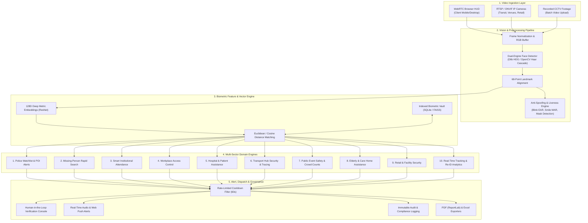
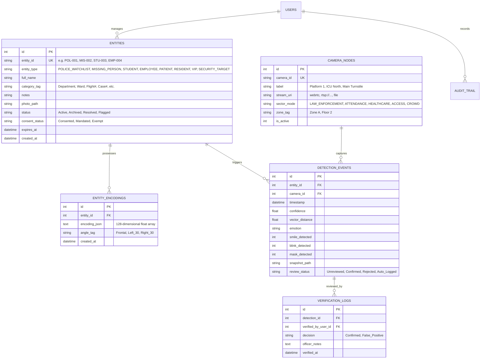

# FaceTrack AI — Multi-Sector Implementation & Engineering Roadmap

## Executive Summary & Strategic Shift

**FaceTrack AI** is transitioning from a specialized student attendance management prototype into an **enterprise-grade, multi-sector Facial Intelligence, Biometric Verification, and Real-Time Person Tracking Platform**. 

While educational attendance remains one of its supported operational profiles, the core computer vision engine, biometric encoding pipeline, and detection infrastructure are architected to deliver touchless identification, automated search-and-alert workflows, and spatial analytics across **10 distinct industry sectors**.

This implementation plan defines the architectural blueprint, data model evolution, technical specifications for all 10 use cases, ethical and privacy governance frameworks, and phased execution milestones.

---

## 1. System Vision & Architecture

### 1.1 High-Level Architecture Diagram

### 1.2 Core Architectural Principles
1. **Domain-Agnostic Biometric Kernel**: The face detection, alignment, feature extraction, and vector matching pipeline operates independently of the target entity's semantic type.
2. **Pluggable Domain Engines**: Each vertical (e.g., Missing Persons vs. Access Control vs. Hospital Safety) implements tailored validation rules, alert thresholds, and privacy policies.
3. **Mandatory Human-in-the-Loop (HITL)**: For sensitive enforcement, missing person alerts, and clinical notifications, automated matching serves strictly as an initial advisory signal requiring authorized human confirmation.
4. **Edge & Browser Compatibility**: Zero-dependency client operation via WebRTC and HTML5 Canvas HUD, functioning on standard commodity hardware with low latency.
5. **Privacy by Design**: Biometric data stored as one-way 128D mathematical vectors rather than raw facial imagery wherever strict privacy mandates apply.

---

## 2. Comprehensive 10-Sector Specifications

| # | Sector | Primary Objective | Data Inputs & References | Trigger & Match Threshold | Alert & Operational Workflow | Ethical & Privacy Safeguards |
|---|---|---|---|---|---|---|
| **1** | **Police Assistance & POI Alerts** | Assist authorized law enforcement in reviewing live or recorded CCTV feeds at railway stations, bus stands, and checkpoints against legal watchlists. | Authorized reference photos of persons of interest (court or police order); live/archival RTSP streams. | Strict tolerance ($d \le 0.42$ / Confidence $\ge 85\%$). | Flag candidate match, freeze timestamped snapshot, alert field officers via secure dashboard for mandatory human review. | Strict chain of custody, tamper-evident audit logs, non-biometric data segregation, legal jurisdiction limits. |
| **2** | **Missing-Person Assistance** | Accelerate search-and-rescue operations by scanning available footage for missing children, elders, or vulnerable individuals. | Family/police-approved reference image; multi-camera feeds and archived footage. | Balanced tolerance ($d \le 0.48$ / Confidence $\ge 75\%$) to account for lighting, aging, and distress. | High-priority visual alert on operator HUD, chronological sighting trail generation across camera timestamps. | Consent-governed enrollment; immediate post-recovery record archiving and de-enrollment option. |
| **3** | **Smart College & Institutional Attendance** | Modernize institutional attendance recording, eliminate proxy check-ins, and generate departmental analytics. | Enrolled student registry (ID, department, semester); campus entry & lecture hall cameras. | Standard tolerance ($d \le 0.50$ / Confidence $\ge 70\%$). | Single check-in per session, anti-duplicate entry guard, audio chime, instant daily/monthly report sync. | Institutional privacy policy adherence; local on-premise storage; opt-out or manual fallback options. |
| **4** | **Workplace Access Management** | Touchless turnstile and door access verification for registered staff and visitors. | Employee profiles, authorized badges, active shift rosters; door terminal webcams. | High tolerance ($d \le 0.45$ / Confidence $\ge 80\%$) + liveness check (blink/smile). | Instant access granted/denied pulse, real-time security desk notification on unrecognized or unauthorized attempts. | SOC2 / ISO 27001 workplace compliance, encrypted template storage, automated visitor record expiration. |
| **5** | **Hospital & Patient Assistance** | Assist healthcare workers in identifying registered patients, preventing disoriented individuals from wandering into dangerous areas. | Consent-based patient enrollment (geriatric, psychiatric, memory-care wards); perimeter cameras. | Sensitive tolerance ($d \le 0.48$ / Confidence $\ge 75\%$). | Instant silent alert to nursing station if patient approaches exit gates or restricted wings. | Strict HIPAA / medical privacy compliance, patient/guardian written consent, restricted authorized-only viewing. |
| **6** | **Transport Hub Security** | Trace movement of authorized persons of interest across airport terminals, railway platforms, and bus hubs. | Authorized security watchlist; distributed RTSP multi-camera network across gates, concourses, platforms. | Multi-tier tolerance ($d \le 0.42$ primary, $d \le 0.48$ secondary investigative). | Cross-camera timeline reconstruction, spatial trajectory mapping, incident review dossier export. | Strict role-based access control (RBAC), automatic purging of non-matched video buffers within 24-72 hours. |
| **7** | **Public-Event Safety & Crowd Intelligence** | Support incident review at concerts, festivals, stadiums; provide crowd density metrics without individual profiling. | Authorized safety watchlists; wide-angle event security cameras. | Watchlist: $d \le 0.42$. Crowd counting: anonymous head/face density bounding boxes. | Bottleneck / density surge threshold alarms; immediate alert to venue command center for incident investigation. | Anonymous crowd processing by default; facial recognition restricted exclusively to legally authorized threats. |
| **8** | **Elderly & Vulnerable Person Care** | Protect vulnerable residents in assisted living facilities and memory care centers by alerting staff if a resident wanders away. | Consent-based resident registration by family/caregivers; corridor and perimeter exit cameras. | Gentle tolerance ($d \le 0.48$ / Confidence $\ge 75\%$). | Instant audio chime and dashboard notification to caregivers with camera location and resident name. | Dignity-first protocols, local non-cloud storage, strict guardian consent, emergency-only alert routing. |
| **9** | **Retail & Facility Security** | Deter organized retail theft, protect back-office vaults, and optionally greet opt-in VIP loyalty members. | Known repeat offender watchlist (legally authorized) & opt-in VIP customer registry; entrance/staff-only cameras. | Security: $d \le 0.44$. VIP: $d \le 0.46$. | Discretely alert floor loss-prevention personnel or notify customer service representative for VIP arrivals. | Strict distinction between loss-prevention and customer analytics; transparent retail surveillance signage. |
| **10** | **Real-Time Person Tracking & Spatial Analytics** | Provide continuous person tracking, multi-camera re-identification (Re-ID), dwell time, and spatial movement analytics. | Multi-camera RTSP/WebRTC feeds across zoned facility floor plans. | Feature embedding similarity + spatial continuity matching across adjacent camera nodes. | Live trajectory overlay on facility map, heatmap rendering, dwell time breakdown, path reconstruction. | Anonymized trajectory hashing, zero personally identifiable information (PII) required for pure spatial analytics. |

---

## 3. Unified Universal Data Model

To support all 10 sectors without fragmentation, the SQLite database is refactored from isolated student/target tables into a **polymorphic, unified entity model**:

### 3.1 Entity Relationship Diagram

---

## 4. Technical Implementation Phases

### Phase 1: Core Foundation & Multi-Sector Schema Unification *(In Progress / Completed)*
- [x] Dual-engine computer vision pipeline (Dlib ResNet 128D embeddings + Haar Cascade fallback).
- [x] Liveness feature analysis (Blink EAR, Smile MAR, Emotion detection, Mask verification).
- [x] WebRTC client HUD with real-time Canvas bounding boxes and voice alerts.
- [x] Rate-limiting cooldown algorithm (in-memory + SQL cache) to eliminate database flooding.
- [x] SQLite database schema migration supporting generic targets and audit logs.
- [x] PDF generation (ReportLab) and analytics dashboard structure.

### Phase 2: Multi-Stream Video Ingestion & Spatial Tracking Engine *(Next Milestone)*
- [ ] **RTSP & ONVIF Stream Ingestor**: Background worker utilizing OpenCV `VideoCapture` with asynchronous threading to ingest multiple network security camera streams.
- [ ] **Cross-Camera Re-Identification (Re-ID)**: Tracking target movement across camera handoffs using spatial continuity and timestamp gating.
- [ ] **Batch Video Upload Reviewer**: Interface allowing authorized operators to upload pre-recorded CCTV footage (`.mp4`, `.avi`, `.mkv`), extracting frames at 1-second intervals for rapid target searching.
- [ ] **Anonymized Crowd Counter**: Head and face density detector generating occupancy count and congestion warnings without storing biometric embeddings.

### Phase 3: Sector-Specific Modules & Human-in-the-Loop Console
- [ ] **Law Enforcement & Missing-Person HITL Portal**: Dual-pane confirmation modal comparing registered reference photos with captured probe frames, requiring explicit operator sign-off before logging a positive hit.
- [ ] **Healthcare & Assisted Living Guard**: Geofenced boundary alert rules triggering notifications when registered patients/residents enter unauthorized zones.
- [ ] **Access Control & Shift Rules Engine**: Door relay integration (HTTP webhook / MQTT) to trigger physical turnstile strikes upon valid employee verification.
- [ ] **Advanced Attendance Module**: Course, section, and semester filtering with automated daily absence notifications.

### Phase 4: Enterprise Scaling, Vector Acceleration & Edge Inference
- [ ] **Vector Database Integration**: Optional migration to FAISS / Milvus for sub-millisecond similarity lookups against 100,000+ enrolled subjects.
- [ ] **Modern Deep Face Backends**: Support for RetinaFace + InsightFace (ArcFace 512D) for extreme angle and low-light accuracy.
- [ ] **Hardware Acceleration**: GPU batch inference via NVIDIA TensorRT and Apple Silicon CoreML.
- [ ] **Mobile Officer Companion App**: Progressive Web App (PWA) with push notifications for authorized patrol officers and security teams.

---

## 5. Security, Ethics & Privacy Governance

1. **Role-Based Access Control (RBAC)**:
   - `Super Admin`: System configuration, user management, audit review.
   - `Authorized Operator`: Daily monitoring, watchlist management, event reviews.
   - `Verifier / Officer`: Human-in-the-loop review and hit confirmation only.
   - `Auditor`: Read-only access to immutable compliance logs.

2. **Data Minimization & Automated Purge**:
   - Frames without a target match are instantly discarded from RAM; no video buffers are persisted unless flagged during an active investigation.
   - Routine detection logs are purged automatically based on configurable sector retention policies (e.g., 30 days for attendance, 72 hours for retail).

3. **Cryptographic Protection**:
   - All biometric vector arrays are encrypted at rest using AES-256.
   - All network transit (WebRTC, REST APIs, RTSP streams) enforced over HTTPS / TLS 1.3.

4. **Compliance Alignment**:
   - **GDPR (EU) & DPDP Act (India)**: Explicit consent-based enrollment for civilian, workplace, healthcare, and educational applications.
   - **HIPAA (USA)**: Patient identity and biometric safeguarding in healthcare and memory care environments.
   - **Law Enforcement Standards (CJIS)**: Strict chain of custody, tamper-evident audit logs, and non-biometric data segregation.
